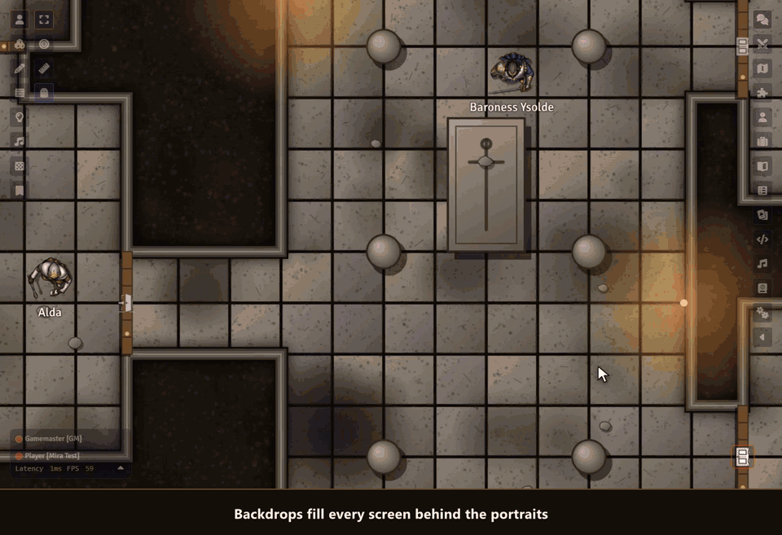

# Sephral’s Token Wardrobe

**Your rogue walks into the tavern in street clothes, climbs into battle gear for the fight and dresses up for the duke’s ball. One click on the sheet or the token puts a look on: portrait and token change together.**

[](#install)
[](https://discord.gg/7BjCgDYaBP)
[](https://github.com/Sephral)



## Highlights

* **A conversation stage:** the GM brings portraits big onto every screen. One click changes the expression, a mark shows who speaks.
* **Backdrops for the stage:** a wide picture behind the portraits, like a scene of a film: tavern, throne room, forest road. It fades into the next one, pans slowly and takes the light of dawn, dusk or night.
* **Every figure looks different:** place five bandits and each one gets its own look.
* **Feelings of the players:** a happy, worried or angry face floats over the token and the portrait, and the look changes with it.
* **Equipment as trigger:** equip the armor and its outfit follows, take it off and the old look is back.
* **Disguises:** an outfit can carry another name that players see on the token, in chat and on the stage.
* **Outfits by place:** a Region puts an outfit on every token that enters it.
* **Made for players:** a shirt button on the sheet and a palette in the token HUD. Click a look, done.
* **Drop images in:** from your computer, Foundry’s file browser or another character.
* **Outfits that put themselves on:** battle gear when the fight starts, a bloodied look below half the hit points. Afterwards your chosen look comes back.

## How it works

1. Open the wardrobe from the shirt button on a sheet, the token HUD or the actor sidebar, and click *Start with three outfits*.
2. Drop pictures onto the cards and click *Put on*.
3. Players switch looks on their own sheet or token. The GM decides in the settings what players may do.
4. For a conversation, right click an actor in the sidebar and choose *Bring to the conversation stage*.

## Install

Token Wardrobe is not in Foundry's module search. Copy this link:

```text
https://github.com/Sephral/sephrals-token-wardrobe/releases/latest/download/module.json
```

1. In Foundry's setup screen open **Add-on Modules** and click **Install Module**.
2. Paste the link into **Manifest URL** at the bottom of the window.
3. Click **Install**, then enable the module in your world.

On The Forge open the Bazaar, click **Install From Manifest** and paste the link.


Foundry VTT 13 and 14 · any game system · English and German

## Learn more

Every button, setting and the macro API are explained in the [manual](MANUAL.md). Questions or ideas? Join us on [Discord](https://discord.gg/7BjCgDYaBP). Looking for more? See [all modules by Sephral](https://github.com/Sephral).

## License

See [LICENSE.md](LICENSE.md).
